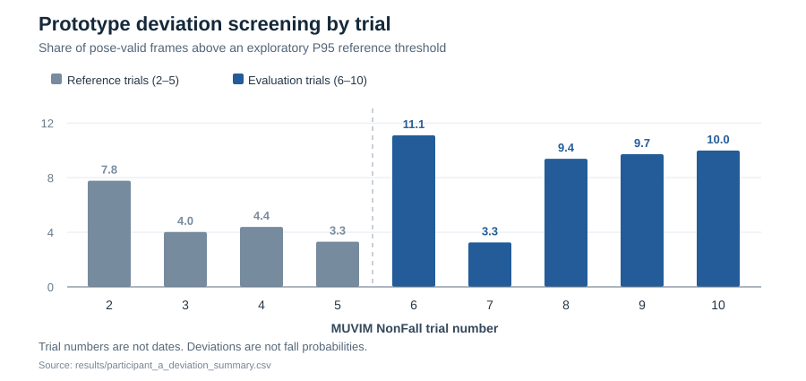

# Analyzing Motion Changes from RGB Pose Data

[日本語版 README](README_JA.md)

I built this Python project during my master's research at Hosei University. It extracts pose landmarks from RGB images, calculates motion features, and compares them with a reference distribution of daily activities. My longer-term research goal is to understand whether changes in everyday movement can contribute to fall-risk assessment.

**This repository is an early analysis prototype, not a validated fall-risk prediction system.**

## Why I built it

In an earlier study, I used skeletal features and Random Forest to distinguish fall and non-fall video segments (5-fold cross-validation accuracy: **77.1% ± 17.7%**). I also examined the model's decisions with SHAP and LIME and presented that work at the [67th Annual Meeting of the Japan Ergonomics Society](https://pub.confit.atlas.jp/ja/event/jes67/presentation/1B2-03).

That work raised a question: recognizing motion immediately around a fall is different from assessing how a person's usual movement may be changing. I therefore started testing a reference-based approach using daily-activity videos from the MUVIM dataset.

## What I implemented

The public code covers four steps:

| Step | Implementation |
| --- | --- |
| Pose extraction | [`extract_pose.py`](src/extract_pose.py) extracts 33 MediaPipe landmarks from RGB frames and retains original frame numbers, including failed detections. |
| Motion features | [`extract_features.py`](src/extract_features.py) calculates eight image-space features without bridging gaps between detected frames. |
| Reference and deviation | [`analyze_individual_deviation.py`](src/analyze_individual_deviation.py) uses Median/MAD to form a reference and computes standardized deviations, an exploratory threshold, EWMA, and feature-level summaries. |
| Trial-group comparison | [`compare_participants.py`](src/compare_participants.py) summarizes feature distributions for user-specified groups of trials. |

The implementation uses **Python, NumPy, pandas, OpenCV, and MediaPipe Pose**. The Random Forest and SHAP/LIME work described above was part of an earlier study; its code is not included in this repository.

## What I found when I checked the measurements

My first scores included large changes in shoulder-line orientation. Looking back at the original RGB frames showed cases where the left/right landmark assignments switched or where the shoulder points nearly overlapped. The computed angle changed sharply even though the images did not show a corresponding turn.

I also reviewed pose availability and activity content in **29 MUVIM trials**. Selected sitting segments sometimes had more usable ankle landmarks than short movement segments. In other words, a detected pose—or even high landmark visibility—does not by itself establish that a gait feature is being measured reliably.

Those checks changed how I approach the research: **before interpreting a change in a score, I need to confirm what the feature measures and whether the source frames support that interpretation.** These later validation checks were conducted separately; their full scripts and source images are not part of this public prototype.

## Current measurement and validation work

I am designing a comparison procedure using the laboratory's **VENUS3D three-dimensional position measurement system** as a reference to evaluate perspective correction in RGB images. Rather than retaining all eight prototype features by default, I am defining the measurements and conditions needed to relate image-derived values to physical distances and speeds.

The design covers three areas:

- **Recording conditions and measurement coverage:** Record the same movement with RGB and VENUS3D, then examine how camera distance and measurement-point height affect image-derived values. The procedure will retain records of unmeasurable intervals as well as intervals with valid measurements.
- **Evaluation of correction methods:** Compare errors only for quantities expressed in matching units. Keep records used for calibration and parameter selection separate from records used for evaluation.
- **Correspondence with Xsens DOT:** Define the measured quantities, units, sensor mounting orientation, and time alignment needed for supplementary comparisons of orientation and angular velocity.

VENUS3D markers and MediaPipe landmarks do not necessarily represent identical locations, so defining corresponding points is also part of this work. **The current work is experimental and evaluation-procedure design; accuracy evaluation using synchronized RGB and VENUS3D/DOT recordings has not yet been performed.** Code and results for this validation are not yet included in this repository.

## Example from the public prototype



This chart uses the saved [trial summary CSV](results/participant_a_deviation_summary.csv). The code uses `NonFall2–5` as reference trials and `NonFall6–10` as evaluation trials. **These are analysis groupings, not a verified past-to-future sequence.** Each percentage refers to valid frames exceeding a prototype threshold, not a probability of falling.

The labels A/B/C in other saved outputs are **provisional trial-group names**; their relationship to formal participant IDs has not been confirmed. Two original PNG figures are retained as historical exports and still contain older “Participant” labels. They should not be read as evidence that three individual identities were verified.

## Reproduce the prototype

Python 3.10+ is recommended. Install the packages in [requirements.txt](requirements.txt), obtain access to the MUVIM image data, and provide a local MediaPipe Pose Landmarker model file. The raw dataset is not redistributed here; see [DATASET.md](DATASET.md).

```bash
pip install -r requirements.txt

python src/extract_pose.py \
  --input-root /path/to/ZED_RGB_ADL_COM \
  --output-dir work/pose \
  --model /path/to/pose_landmarker_lite.task \
  --trials 2-10

python src/extract_features.py \
  --pose-dir work/pose \
  --output-dir work/features \
  --trials 2-10

python src/analyze_individual_deviation.py \
  --feature-dir work/features \
  --output-dir work/analysis \
  --baseline 2-5 --evaluation 6-10 --percentile 95 --alpha 0.4
```

To inspect the provisional trial groups, run [`compare_participants.py`](src/compare_participants.py) with `--group A:2-10 --group B:71-80 --group C:81-90`. All input paths must refer to locally obtained data.

## Interpretation and next steps

Several variable names in the prototype are shorthand, not physical units:

- `velocity` is **hip-center displacement per frame** in normalized image coordinates, not walking speed in m/s.
- `acceleration` is a difference between displacement values, not acceleration in m/s².
- `body_turn_rate` is a shoulder-line angle difference, not angular velocity.

Camera viewpoint, uncertain frame timing, mixed activities, and missing or unstable landmarks limit what can be inferred from these values. In a separate exploratory analysis of published follow-up datasets, adding within-person change did **not** show a stable improvement in predicting future falls.

---

**ZHANG MENGYUE** · M.S. candidate, Graduate School of Science and Engineering, Hosei University  
[Japanese README](README_JA.md) · [Dataset and redistribution notes](DATASET.md)
