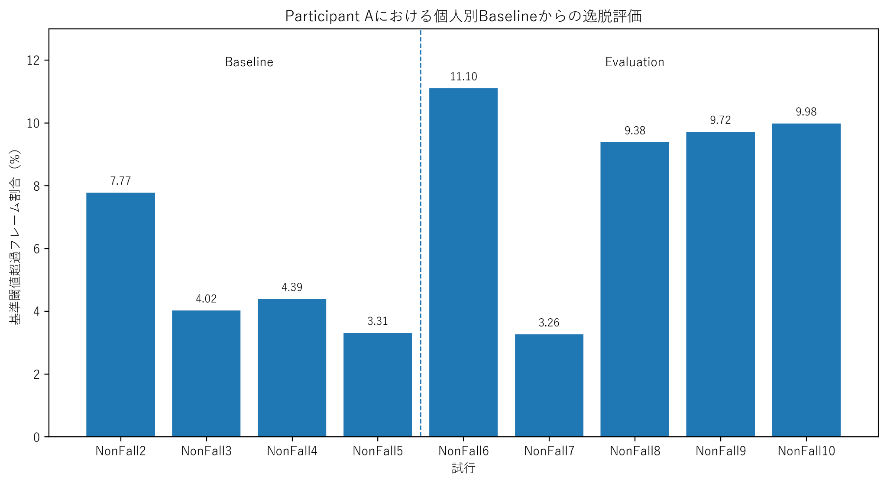
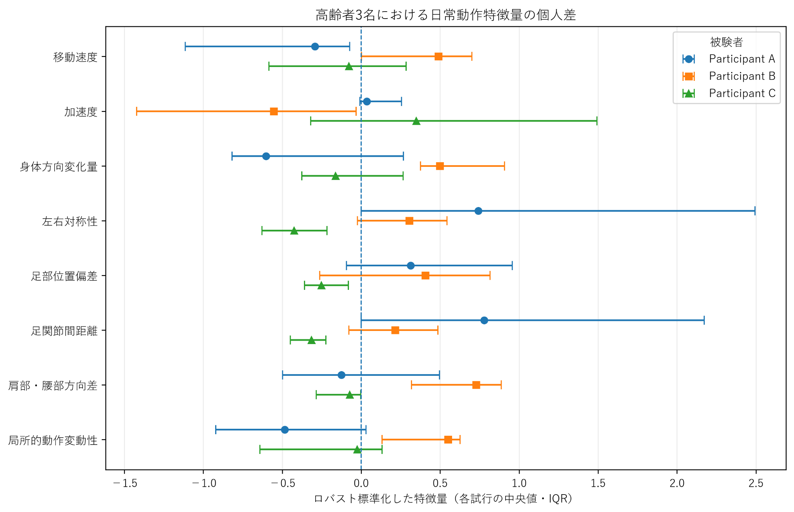

# 高齢者の日常動作における個人内変化分析

[English README](README.md)

RGB映像と骨格情報から、**本人の日常動作の変化を個人内で評価する**ための研究用Pythonプロジェクトです。

全員に同じ基準を当てはめるのではなく、本人の普段の動作を参照し、通常状態からの変化を定量化することを目的としています。

> **研究段階:** このリポジトリは探索的な試作コードを公開したものです。ここで算出する逸脱度は**転倒確率ではなく**、臨床的な転倒リスク判定システムでもありません。

## 研究の背景

前期研究では、UR Fall Detection Datasetを用い、骨格特徴量からRandom Forestで転倒・日常動作を分類しました。5分割交差検証の平均精度は **77.1% ± 17.7%** で、SHAP / LIMEを用いてモデルの判断根拠も分析し、日本人間工学会第67回大会で発表しました。

その後、研究上の課題として「転倒直前にのみ現れる特徴」ではなく、**本人の普段の状態からの変化**を捉える必要があると考え、MUVIMの高齢者ADLデータを用いた個人別評価へ研究を発展させています。

現在の中心的な問いは次の通りです。

**本人の日常動作の変化を、転倒リスクと結び付ける前に、まずどこまで安定して測定・定量化できるか。**

## このリポジトリに含まれるもの

- MediaPipe PoseによるRGB映像からの骨格ランドマーク抽出
- Pose未検出フレームを考慮したフレーム連続性の処理
- 8種類の画像座標上の動作特徴量
- Median / MADを用いた個人別Baseline
- 標準化逸脱度とDeviation Score
- 百分位点を用いた探索的な大きな逸脱の抽出
- EWMAによる試行間の逐次評価
- 特徴量別の寄与割合の集計
- 暫定的な試行グループ間比較
- 小規模な集約結果と図

### 公開範囲について

このリポジトリは、研究の**初期試作段階**を就職活動向けに整理したものです。

その後の研究では、Pose出力率、landmark visibility、フレーム連続性、特徴量の定義、Baselineに用いる試行、閾値、EWMA条件、原画像との対応などを追加で確認しています。これらの後続検証コードや研究データのすべてを、この公開リポジトリに含めているわけではありません。

また、コード中の **A / B / C** は暫定的な試行グループ名です。正式な被験者IDとの対応は未確認であるため、本リポジトリでは「3名の高齢者」とは扱いません。

## 解析フロー

1. RGBフレーム
2. MediaPipe Poseによる骨格ランドマーク抽出
3. フレーム連続性の確認
4. 画像座標上の動作特徴量の計算
5. Median / MADによる個人別Baselineの構築
6. 標準化逸脱度の算出
7. 探索的なDeviation Scoreへの統合
8. EWMAによる逐次的な集約
9. 特徴量別・試行グループ別の比較

## 特徴量の意味

ソースコードでは再現性のため旧変数名を残していますが、いくつかの名称は物理量として解釈しないよう注意が必要です。

| 変数名 | 現在のコードで実際に計算している量 |
|---|---|
| `velocity` | 左右股関節の中点の、隣接フレーム間の2次元移動量。**実際の歩行速度（m/s）ではありません。** |
| `acceleration` | 連続する移動量どうしの差。**m/s²の加速度ではありません。** |
| `body_turn_rate` | 肩線方向角のフレーム間変化の絶対値。**角速度ではありません。** |
| `symmetry` | 左右足関節の画像y座標差の絶対値。 |
| `foot_offset` | 左右足関節と股関節中点との画像x方向距離の平均。 |
| `ankle_distance` | 左右足関節間の画像上の2次元距離。 |
| `shoulder_hip_angle` | 同一フレーム内の肩線と股関節線の方向差。 |
| `movement_variability` | Poseが連続している区間内での移動量の移動標準偏差（最大15フレーム、5点以上）。 |

これらは画像座標から算出しているため、カメラ方向、投影、Pose推定誤差、欠損の影響を受けます。

## 個人別Baselineの試作

初期試作では、各特徴量について中央値とMADを用いて基準を作成しています。

```text
robust_sigma = 1.4826 × MAD
standardized_deviation = |x - median| / robust_sigma
```

その後、利用可能な特徴量の標準化逸脱度を平均し、フレームごとのDeviation Scoreを算出しています。

P95等の百分位点やEWMAは、**探索的な評価機構**として実装したものであり、臨床的に妥当性が確認された転倒リスク閾値ではありません。

## 公開コード中の試作例

現在の公開コードでは、例として以下の分割を使用します。

- `NonFall2–5`: Baseline
- `NonFall6–10`: Evaluation

これは試作上の分割であり、**実際の過去→未来の時間順序を表すものではありません**。また、試行番号は日付やリスク値でもありません。



この図は、各評価試行で探索的閾値を超えたフレームの割合を示しています。本人の参照分布からどの程度大きく外れたかを見るための図であり、転倒確率を表すものではありません。

### 暫定試行グループの比較



A / B / Cの暫定試行グループについて、各特徴量の分布を比較した図です。これらはコード上の便宜的なラベルであり、正式な被験者IDとして確定したものではありません。

## データ品質と検証から分かったこと

後続の研究では、Pose由来の特徴量を解釈する際に、次の点が重要であることを確認・整理しています。

- Poseが出力されていても、landmark位置が正しいとは限らない。
- 欠損を「動きが0」として扱わない。
- 移動量等を計算する際には、元フレームの連続性を確認する必要がある。
- 一部の原画像では、landmarkの左右対応変化や肩点の近接が極端な角度変化に影響する例があった。
- 画像座標から得た値は、時間・空間校正なしに実速度や実距離と呼べない。
- 異なる日常動作をまとめると、身体能力が変わらなくても特徴量分布が変化し得る。
- Baselineに選ぶ試行、百分位点、EWMAの重み、観測順序によって探索結果は変わり得る。
- 個人内逸脱と将来転倒リスクの関係は、別途検証が必要である。

そのため、現在の研究では、単にスコアを出すことよりも先に、**「何を測っているのか」「その値をどこまで信頼して解釈できるか」**を確認することを重視しています。

## このプロジェクトで示せる技術経験

- Pythonによるデータ処理・分析
- Computer Vision / Pose Estimationのワークフロー
- 時系列の骨格座標からの特徴量設計
- Median / MADを用いたロバスト統計
- 機械学習モデルの評価
- データ品質確認と技術的な原因調査
- 再現可能な解析パイプライン
- モデル・計測結果を過度に解釈しない検証姿勢

## リポジトリ構成

```text
.
├── README.md
├── README_JA.md
├── DATASET.md
├── requirements.txt
├── figure_sequential_deviation.png
├── figure_participant_comparison.png
├── src/
│   ├── common.py
│   ├── extract_pose.py
│   ├── extract_features.py
│   ├── analyze_individual_deviation.py
│   └── compare_participants.py
└── results/
    ├── participant_a_deviation_summary.csv
    ├── participant_a_feature_contribution.csv
    └── participant_abc_comparison.csv
```

## 実行方法

**Environment:** Python 3.10+

### 1. 依存ライブラリのインストール

```bash
pip install -r requirements.txt
```

### 2. Pose landmarkの抽出

```bash
python src/extract_pose.py \
  --input-root /path/to/ZED_RGB_ADL_COM \
  --output-dir work/pose \
  --model /path/to/pose_landmarker_lite.task \
  --trials 2-10
```

### 3. 動作特徴量の算出

```bash
python src/extract_features.py \
  --pose-dir work/pose \
  --output-dir work/features \
  --trials 2-10
```

### 4. 個人別Baselineと逸脱度の試作

```bash
python src/analyze_individual_deviation.py \
  --feature-dir work/features \
  --output-dir work/analysis \
  --baseline 2-5 \
  --evaluation 6-10 \
  --percentile 95 \
  --alpha 0.4
```

### 5. 暫定試行グループの比較

```bash
python src/compare_participants.py \
  --feature-dir work/features \
  --output-dir work/comparison \
  --group A:2-10 \
  --group B:71-80 \
  --group C:81-90
```

## データとプライバシー

本研究では **MUVIM (Multi Visual Modality Fall Detection Dataset)** を利用しています。

元の動画、RGB画像、フレーム単位の骨格座標データは、この公開リポジトリでは再配布していません。詳細は [DATASET.md](DATASET.md) を参照してください。

## 使用技術

Python / NumPy / pandas / OpenCV / MediaPipe Pose / scikit-learn / Matplotlib / SHAP / LIME / robust statistics (Median, MAD) / EWMA

## 学会発表

**日本人間工学会第67回大会（2026年5月）**  
「骨格情報と説明可能AIを使った高齢者の転倒リスク評価手法の提案」  
https://pub.confit.atlas.jp/ja/event/jes67/presentation/1B2-03

## Author

**ZHANG MENGYUE（チョウ・ユヅキ）**  
法政大学大学院 理工学研究科 システム理工学専攻
