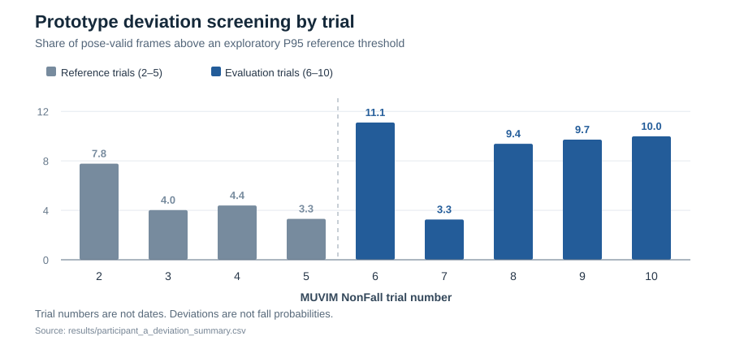

# RGB映像の骨格情報を用いた日常動作の変化分析

[English README](README.md)

法政大学大学院での修士研究の中で作成したPythonの試作プロジェクトです。RGB画像から骨格情報を取得し、動作特徴量を計算して、日常動作の参照データとの違いを調べています。最終的には、本人の動作の変化を将来の転倒リスク評価に役立てられるかを検討したいと考えています。

**公開しているのは動作変化の分析用プロトタイプであり、転倒確率を予測する完成したシステムではありません。**

## 研究のきっかけ

前期は、骨格特徴量とRandom Forestを用いて転倒・非転倒映像を分類しました。5分割交差検証の平均精度は **77.1% ± 17.7%** で、SHAP・LIMEによる判断根拠の分析も行い、[日本人間工学会第67回大会](https://pub.confit.atlas.jp/ja/event/jes67/presentation/1B2-03)で発表しました。

ただし、転倒時の動きを分類できても、普段の生活で「将来転倒しやすいか」が分かるわけではありません。そこで、MUVIMの高齢者日常動作データを使い、本人の普段の状態からの変化を見る方法を試作しました。

## 実装した処理

| 処理 | 対応するコード |
| --- | --- |
| 骨格抽出 | [`extract_pose.py`](src/extract_pose.py)：MediaPipe Poseで33点を取得。検出できないフレームも元番号を保持します。 |
| 特徴量計算 | [`extract_features.py`](src/extract_features.py)：画像座標上の8特徴量を計算。欠損区間をまたいだ差分は計算しません。 |
| 個人別基準と逸脱度 | [`analyze_individual_deviation.py`](src/analyze_individual_deviation.py)：Median・MADによる基準、標準化逸脱度、探索的な閾値、EWMA、特徴量別の集計。 |
| 試行グループの比較 | [`compare_participants.py`](src/compare_participants.py)：指定した試行グループの特徴量分布を集計。 |

使用技術は **Python、NumPy、pandas、OpenCV、MediaPipe Pose** です。前期のRandom Forest・SHAP・LIMEによる解析コードは、このリポジトリには含めていません。

## 数値を原画像と照合して気づいたこと

初期の分析では、肩線の方向角が急激に変化する場面がありました。元の画像と骨格座標を見比べると、左右の肩点の対応が一時的に反転した例や、肩点同士が非常に近づいて方向角が不安定になった例がありました。大きな数値が出ても、実際にその分だけ身体が回転したとは限りません。

また、MUVIMの**29試行**について骨格の利用状況や動作内容を確認すると、短い移動場面より座位の方が足部の情報を取りやすい例もありました。Poseの検出結果があるだけでは、歩行を正しく測定できているとは判断できません。

この経験から、**スコアの大小を解釈する前に、特徴量が何を計算しているのか、元画像と対応しているのかを確認する必要がある**と考えるようになりました。これらの後続検証は公開プロトタイプとは別に実施したもので、全ての検証コードや原画像を本リポジトリに掲載しているわけではありません。

## 公開プロトタイプの出力例



この図は、公開している[試行別集計CSV](results/participant_a_deviation_summary.csv)から作成しました。初期試作では、`NonFall2–5`を基準用、`NonFall6–10`を評価用として扱っています。**この分割は実際の過去と未来の順序ではありません。** 図の値は探索的な基準を超えた有効フレームの割合であり、転倒確率ではありません。

他の出力ファイルに残るA/B/Cは、**暫定的な試行グループ名**です。正式な被験者IDとの対応は未確認です。リポジトリ内に保存している旧PNG図には、初期の「Participant A/B/C」などの表記が残っていますが、3名の本人確認ができたことを示すものではありません。

## 実行方法

Python 3.10以降を想定しています。[requirements.txt](requirements.txt)のライブラリ、利用許可を得たMUVIM画像データ、MediaPipe Pose Landmarkerのモデルファイルが必要です。元データは再配布していません（[DATASET.md](DATASET.md)）。

```bash
pip install -r requirements.txt

python src/extract_pose.py \
  --input-root /path/to/ZED_RGB_ADL_COM \
  --output-dir work/pose \
  --model /path/to/pose_landmarker_lite.task \
  --trials 2-10

python src/extract_features.py \
  --pose-dir work/pose \
  --output-dir work/features \
  --trials 2-10

python src/analyze_individual_deviation.py \
  --feature-dir work/features \
  --output-dir work/analysis \
  --baseline 2-5 --evaluation 6-10 --percentile 95 --alpha 0.4
```

試行グループの集計には [`compare_participants.py`](src/compare_participants.py) を使用し、`--group A:2-10 --group B:71-80 --group C:81-90` のように指定します。入力はすべて手元のデータを参照してください。

## 数値の解釈と今後の課題

コード中には初期の変数名が残っていますが、実際に計算しているのは次の量です。

- `velocity`：画像座標上の腰部中点の**フレーム間移動量**。m/s単位の歩行速度ではありません。
- `acceleration`：連続する移動量の**差分**。m/s²単位の加速度ではありません。
- `body_turn_rate`：肩線の方向角の**フレーム間差**。角速度ではありません。

撮影方向、フレームの時間情報、動作内容の混在、骨格点の欠損や誤推定を考慮する必要があります。また、別の公開追跡データを用いた予備解析では、個人内の変化を加えることによる**安定した将来転倒予測の改善は確認できませんでした**。

次は、固定したRGBカメラと **Xsens DOT** 慣性センサで単純な動作を同時に記録し、対応する測定値や欠損を比較することを提案しています。**これは計画段階であり、実験済み・実装済みではありません。**

---

**ZHANG MENGYUE（チョウ・ユヅキ）**  
法政大学大学院 理工学研究科 システム理工学専攻  
[English README](README.md) ・ [データセットの取り扱い](DATASET.md)
